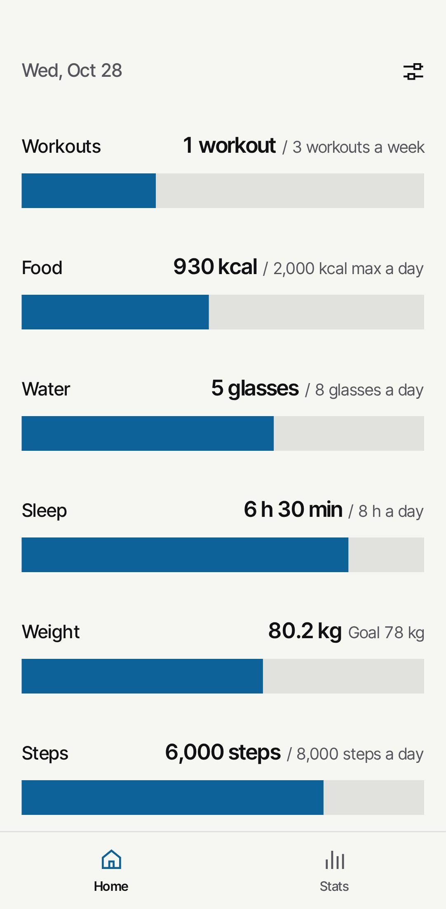
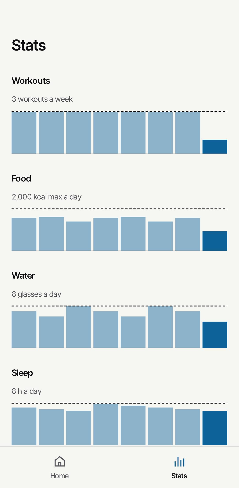

# Trackline

A small, private, local tracker for workouts, food, sleep, and anything else you want to keep track of.

<p>
  
  
</p>

## Add it to your phone

- **iPhone:** open [trackline.app](https://trackline.app) in Safari, tap Share, then Add to Home Screen.
- **Android:** open [trackline.app](https://trackline.app) in Chrome, tap the menu, then Install app.

Other browsers are on the [install page](https://trackline.app/install).

## Building it

You'll need Node 24+ and pnpm.

```sh
pnpm install
pnpm dev     # run it locally
pnpm check   # lint, tests, and build, same as CI
pnpm build   # static site in build/
```

`build/` is plain static files, so any HTTPS host works. Unknown paths should fall back to `build/404.html`. If it lives in a subfolder, build with `BASE_PATH=/subfolder`.

`CLAUDE.md` and `docs/adr/` explain how the code is put together.

## License

[GPL-3.0](LICENSE). If Trackline is useful to you, you can [buy me a coffee on Ko-fi](https://ko-fi.com/algificsoftware).
